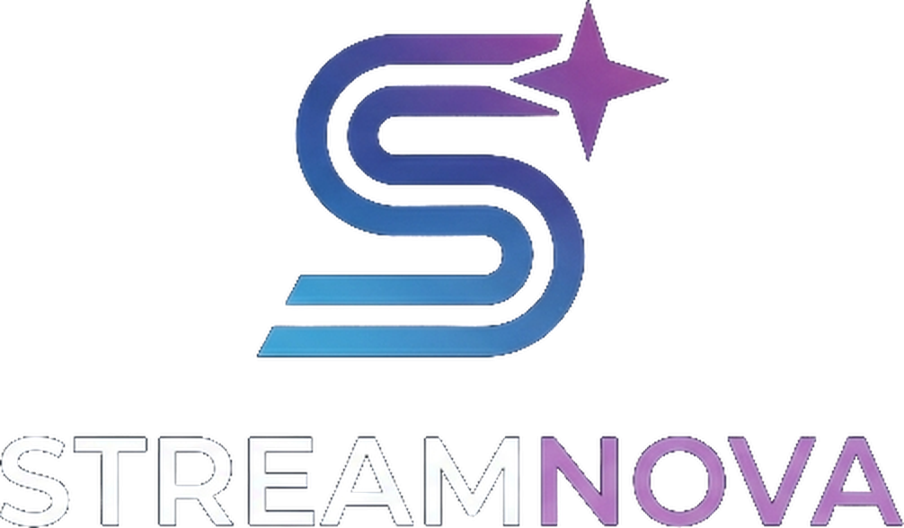

<div align="center">

</div>

# StreamNova 🚀

**StreamNova** è un'applicazione moderna per **Android TV** sviluppata in **Kotlin** e **Jetpack Compose**, progettata specificamente per offrire un'esperienza di streaming fluida, elegante e ottimizzata per l'uso con il telecomando (D-Pad).

## ✨ Caratteristiche Principali

* **⚡ Navigazione Fluida per TV:** Interfaccia reattiva e pulita, progettata nativamente per la navigazione da divano con il D-Pad.

* **🔗 Integrazione Debrid Avanzata:** Supporto per lo streaming diretto HTTP ad alte prestazioni tramite servizi Debrid (TorBox e Real-Debrid) con verifica della cache.

* **🎬 Cataloghi e Sincronizzazione:** Sincronizzazione completa tramite account Trakt.tv e cataloghi multimediali ottimizzati (con fix dedicati per provider e reti TV).

* **🎯 Prestazioni e Stabilità:** Un'architettura solida basata su ExoPlayer/Media3 per una riproduzione multimediale impeccabile.

## 🎨 Identità Visiva & Design

StreamNova cura ogni dettaglio grafico per integrarsi alla perfezione con i moderni launcher per TV:

* **Splash Screen Dedicato:** Schermata di avvio pulita con logo geometrico e animazione di caricamento.

* **Sidebar Dinamica:** Header interattivo che mostra l'icona minimalista a barra chiusa e svela il logo completo all'espansione.

* **Banner 16:9 & Icone Perfette:** Tile e banner nativi progettati senza tagli o deformazioni sia su Google TV che su Amazon Fire TV.

## 🔑 Configurazione della chiave API TMDB

La chiave TMDB **non è nel repository**. Per compilare con il catalogo TMDB attivo, impostala localmente in uno di questi modi (nessuno dei file è tracciato da Git):

1. **`local.properties`** — aggiungi una riga `TMDB_API_KEY=<la-tua-chiave>` accanto a `sdk.dir`.

2. **Variabile d'ambiente** — prima di avviare Gradle:

```powershell
$env:TMDB_API_KEY = "<la-tua-chiave>"
```

3. **File `.env`** — copia `.env.example` in `.env` e compila il valore.

Ottieni una chiave gratuita su [themoviedb.org/settings/api](https://www.themoviedb.org/settings/api). Senza chiave l'app compila e si avvia normalmente: il catalogo TMDB resta semplicemente vuoto.

> Nota: una chiave incorporata nell'APK è estraibile da chiunque. Configurarla fuori dal repository serve a non pubblicarla, non a tenerla segreta nell'app.

## 📥 Download & Installazione

1. Scarica il file **`StreamNova.apk`** dall'ultima release ufficiale.

2. Trasferisci l'APK sul tuo dispositivo TV (tramite app come *Send Files to TV* o un file manager di rete).

3. Apri il file sul dispositivo e procedi all'installazione pulita.
